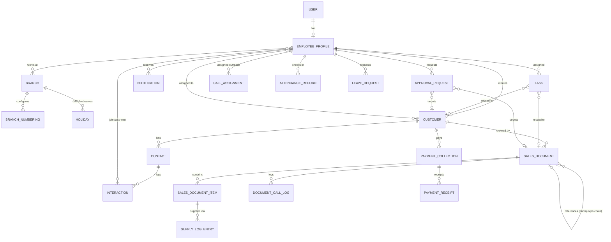

# Anupam 360 → Django `/360/` — Phase 0 Audit

Source: `contact_management.html` (15,189 lines). Line numbers below are **original file**
line numbers (= stripped-file line + 444, since the audit script dropped lines 1–444 of
inlined vendor libs before grepping). All referenced functions were located and read in
the source; "not yet deep-read" is called out explicitly where a module's UI/JS wasn't
fully traced during this pass (it will be read function-by-function during Phase 3 porting).

## 1. Feature inventory → line ranges

| Module | Key functions found | Approx. original lines |
|---|---|---|
| Role/permission helpers | `isAdmin/isBranchManager/isBranchStaff/isSalesManager`, `canSeeDashboard`, `usesPersonalDashboard`, `canDirectEditDelete`, `canEditCustomerDirect`, `canDeleteCustomerDirect`, `canDirectEditDeleteSalesDoc`, `namesInManagerScope`, `employeeBranches` | 4251–4283 |
| Storage shim (to be deleted) | `getShared/setShared/getPersonal/setPersonal` (wraps `window.storage`) | 4284–4293 |
| Role migration on load | `loadAllShared()` — renames `Sales Staff`→`Sales Manager`, deletes `Dispatch Team` accounts | 4294–4305 (inside loader, lines continue past 444) |
| Customer visibility | `visibleCompanies()` (4294+5063), `ctVisible()` (contact-level access list), `assignedToArr()` | 5055–5073 |
| Approval queue | `visibleApprovals()` (8201), `requestSalesDocDelete`, `requestSalesDocEdit`, customer `customer-access` request type (~8054, ~8449–8475, ~8491–8520, ~8525) | 8054, 8201–8230, 8449–8530 |
| Sales doc visibility | `visibleSalesDocs(type)` — Sales Manager scoping rule for quotation/enquiry only | 8306–8321 |
| Numbering | `NUMBERING_TYPES`, `DEFAULT_NUMBERING`, `branchNumberingCfg`, `numberingCounterKey`, `formatDocNumber`, `nextDocNumber`, `bumpDocCounter`, `docNumberSeq` | 3586–3601 (constants), 8598–8635 (logic) |
| Sales doc config | `SALES_DOC_CONFIG` (enquiry/quotation/po/dc/proforma), `COLUMN_META`, `DEFAULT_DOC_THEME` | 3622–3719 |
| Totals/amount math | item line calc (discount-fold vs show-discount, tax per line, packing/freight/other charges each with their own tax %, round-off) | 8784–8850 |
| Backup/restore | `BACKUP_ITEMS` (full key list + labels), `buildBackupObject`, `downloadJson`, `backupDescribe`, restore handler (wipes & reloads everything in the array, downloads a pre-restore safety copy) | 6555–6600 (array), 6660–6720 (export/import handlers) |
| Default seed lists | `DEFAULT_BRANCHES`, `DEFAULT_JOB_TITLES`, `DEFAULT_SOURCES`, `DEFAULT_INDUSTRIES`, `DEFAULT_LANGUAGES`, `DEFAULT_BRANDS`, `DEFAULT_PRODUCTS`, `DEFAULT_CATEGORIES`, `DEFAULT_UNITS`, `DEFAULT_TAX_RATES`, `DEFAULT_PAYMENT_TERMS` (no default transport/courier lists — start empty) | 3585–3832 |

Modules **not yet deep-read line-by-line** (confirmed to exist via grep, behaviour to be
traced function-by-function during Phase 3, per the "don't guess, find the function" rule):
Contact/Person profile interactions (joint visits, DND, also-met), Map & Nearby (Leaflet),
Tasks auto-close-on-visit, Outreach/calling list, Attendance (geolocation, leave, holidays,
work hours/weekly off), Payment Collection + receipts, Print Label, Reports (5 sub-reports),
Manage Lists CRUD, Import Excel (`TEMPLATE_COLS` + merge-by-name), Users page (reassign-before-remove
flow, `userRecordCounts`), Branches page (letterhead/numbering editor UI), Notifications polling,
PDF/Excel export code (SheetJS/jsPDF/AutoTable call sites), dormant Stock module (confirmed no
sidebar entry exists — grepped nav list, `stockProducts`/`suppliers`/`stockBills`/`stockTransactions`
only appear in `BACKUP_ITEMS` and their own CRUD functions, never in the sidebar nav array).

## 2. ER diagram (target Django models)

Lookup tables (`LookupItem(kind, name, extra)`), `SiteSetting` (singleton), and the dormant
`StockProduct/Supplier/StockBill/StockTransaction` models are omitted from the diagram for
clarity — they have no relations into the graph above except via `legacy_id` bookkeeping.

## 3. Permission matrix (role × action)

| Action | Admin | Branch Manager | Branch Staff | Sales Manager |
|---|---|---|---|---|
| See dashboard | Full | Personal | Personal | Personal |
| Add customer | ✅ | ✅ | ✅ | ✅ |
| Edit/delete customer | ✅ direct | ✅ direct | ✅ **edit** direct, delete → approval* | ❌ edit/delete → approval queue |
| Assign customers / outreach lists | ✅ | ✅ | ❌ | ❌ |
| View customers | All | All | All | Own (created or assigned) only |
| Enquiry/Quotation/Proforma/DC: add | ✅ | ✅ | ✅ | ✅ |
| Enquiry/Quotation/Proforma/DC: edit/delete | ✅ direct | ✅ direct | ✅ direct | **Enquiry**: edit/delete → approval. **Quotation**: cannot edit/delete at all (`canEditDelete = !(isSalesManager() && type==='quotation')`) |
| View sales docs | All | All | All | Own created, **or** for quotation/enquiry: any doc on a customer assigned to them |
| Approve/reject requests | ✅ (sees all) | ✅ (sees only requests from `namesInManagerScope()`) | ❌ | ❌ |
| Users CRUD / status / removal | ✅ only | ❌ | ❌ | ❌ |
| Restore backup | ✅ only | ❌ | ❌ | ❌ |
| Branch setup / numbering | ✅ only | ❌ | ❌ | ❌ |

\* §3.1 of the master prompt states Branch Staff deletes go through `canDeleteCustomerDirect`
(Admin/Branch Manager only) — confirmed: `canDeleteCustomerDirect = isAdmin() || isBranchManager()`,
so **Branch Staff cannot delete a customer directly either** (only edit). Corrected from a
looser reading of §3.1's prose into this matrix.

**Branch Manager scope invariant:** `namesInManagerScope()` = self + every employee whose
`branches` array overlaps the manager's own `branches` array. Used to scope which approval
requests a Branch Manager sees (`visibleApprovals`) and which staff they may assign
customers/outreach to.

## 4. Storage read/write surface

Every mutation in the original app funnels through exactly two primitives — `getShared`/`setShared`
(whole-array JSON under a shared key, visible to all users) and `getPersonal`/`setPersonal`
(per-browser key, used only for `lastBackupAt`-style bookkeeping). There is **no per-record
write** anywhere in the app — every save event (`setShared(KEY_X, arrayOfAllX)`) rewrites the
entire collection. This confirms §3.4's "two users editing at once silently overwrite each
other" risk and is the primary reason the Django API must use per-record endpoints (§4.1 of
the master prompt), not a naive 1:1 port of the save functions.

## 5. Risks

1. **Role matrix nuance already found wrong in the prompt's prose** (Branch Staff delete —
   see §3 footnote above) — fixed in the matrix; `RoleRules` in Phase 1 will encode the
   verified version, not the prompt's paraphrase.
2. **Quotation is special-cased for Sales Manager** (`canEditDelete` at line ~9732/orig
   10176 area: `!(isSalesManager() && d.type === 'quotation')`) — a Sales Manager cannot
   edit/delete a Quotation at all, not even via approval. This must be a hard 403 server-side,
   not merely hidden in the UI.
3. **`stock_ledger` app name collision risk**: the existing repo already has an app called
   `stock_ledger` with its own `Branch`, `UserProfile` (OneToOne `related_name='stock_profile'`,
   roles ADMIN/BRANCH_STAFF/VIEWER) and `role_required` decorator — entirely unrelated to
   Anupam 360's roles/branches. The new `threesixty` app's `Branch` and `EmployeeProfile`
   models are a **different table** (Django namespaces by app_label) but humans reading code
   must not confuse the two. `EmployeeProfile.user` will use `related_name='threesixty_profile'`
   to avoid any accessor-name clash with `stock_profile`.
4. **Numbering race**: `nextDocNumber`/`bumpDocCounter` in the original is a pure
   read-then-write with no locking — fine in a single-browser-tab localStorage world, fatal
   under 3 concurrent Gunicorn workers. Phase 1's `BranchNumbering` service must use
   `select_for_update()` inside `transaction.atomic()`.
5. **Aadhaar/PAN**: confirmed present on `employees[]` records, stored and compared in plaintext
   in the browser. Per §4.1 decision: kept in the DB (HR needs them) but masked in every API
   response except to Admin, and never included in exports/notifications/logs.

## 6. Assumptions changed from §2 of the master prompt

- None of the master prompt's 8 numbered assumptions needed correction after reading the
  code; the one prose clarification above (Branch Staff cannot delete customers directly) is
  a correction to §3.1's summary text, not to §2's assumptions list.
- Added one *new* assumption not covered by §2: the existing `stock_ledger` app's `Branch`/
  `UserProfile` models and `role_required` decorator are a **separate, unrelated system**
  (used for a physical inventory ledger) and are left untouched. `threesixty.Branch` and
  `threesixty.EmployeeProfile` are new, independent models even though the names overlap in
  English.

## 7. Next phase

Phase 1: app scaffold, models, migrations, `RoleRules`, `staff_360_required`, numbering
service (`select_for_update`), seed command (two branches, lookup defaults), Django admin
registration, and tests for permissions + numbering concurrency.
